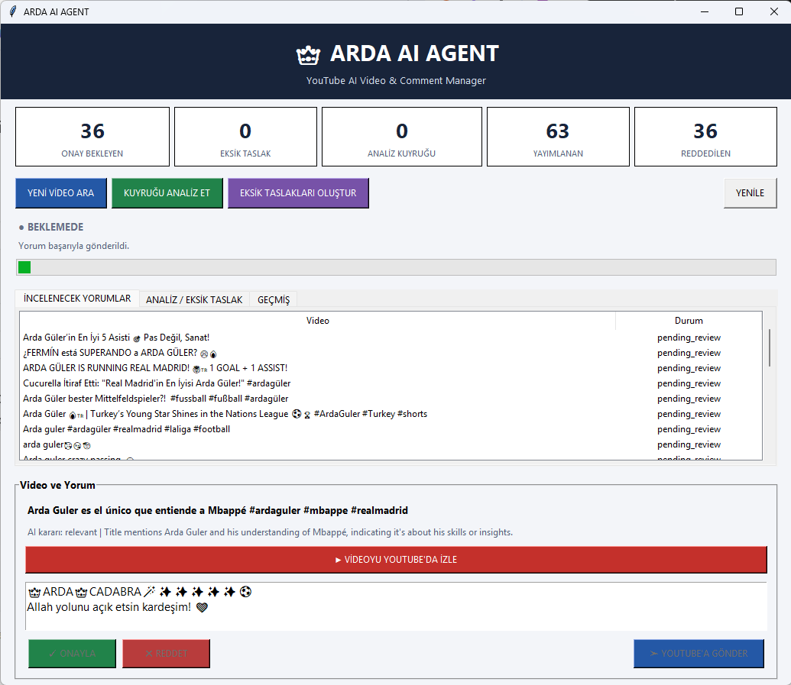

# Arda YouTube AI Agent


**An AI-powered YouTube monitoring, video analysis, and human-in-the-loop engagement system built with Python, LangGraph, Ollama, and the YouTube Data API.**


## Dashboard Preview


## 1. Project Overview


Arda YouTube AI Agent is a desktop-based AI automation application developed as a practical Agentic AI learning project.


It automatically discovers YouTube videos related to Arda Güler and Real Madrid, analyzes them using a locally hosted large language model, generates comment drafts, and allows the user to review comments before publishing.


The system combines traditional automation with AI-based decision-making, structured workflow orchestration, persistent storage, and human oversight.


### Key Features


\- Automated YouTube video discovery

\- Official Real Madrid and LaLiga channel monitoring

\- AI-powered video relevance classification

\- Local LLM inference using Qwen3 1.7B

\- LangGraph-based conditional workflow

\- Automated comment draft generation

\- Human-in-the-loop approval and rejection

\- OAuth-authenticated YouTube comment publishing

\- SQLite database integration

\- Tkinter desktop dashboard

\- Repeated monitoring and reanalysis


\---


## 2. Technology Stack


| Technology | Purpose |

|---|---|

| Python 3.12 | Main application development |

| LangGraph | AI workflow orchestration and conditional routing |

| Ollama | Local LLM inference engine |

| Qwen3 1.7B | Video relevance analysis |

| YouTube Data API v3 | Video discovery and comment publishing |

| SQLite | Persistent storage |

| Tkinter | Desktop graphical interface |

| Google OAuth 2.0 | Authorized YouTube operations |

| PowerShell | Windows application launcher |

| python-dotenv | Environment variable management |

| Git and GitHub | Version control and source-code hosting |


\---


## 3. System Architecture


The application follows a modular architecture.


```text

&#x20;                 USER

&#x20;                   |

&#x20;         +---------+---------+

&#x20;         |                   |

&#x20;         v                   v

&#x20;  start\_agent.ps1     arda\_dashboard.pyw

&#x20;         |                   |

&#x20;         v                   |

&#x20;    main\_agent.py <----------+

&#x20;         |

&#x20;         v

&#x20;   YouTube Data API

&#x20;         |

&#x20;         v

&#x20;   Video Discovery

&#x20;         |

&#x20;         v

&#x20;    SQLite Database

&#x20;         |

&#x20;         v

&#x20;   langgraph\_agent.py

&#x20;         |

&#x20;         v

&#x20;      Ollama

&#x20;    Qwen3 1.7B

&#x20;         |

&#x20;         v

&#x20;   AI Classification

&#x20;         |

&#x20;         v

&#x20;   Comment Drafts

&#x20;         |

&#x20;         v

&#x20;   SQLite Database

&#x20;         |

&#x20;         v

&#x20;   Tkinter Dashboard

&#x20;         |

&#x20;         v

&#x20;   Human Approval

&#x20;         |

&#x20;         v

&#x20;    youtube\_post.py

&#x20;         |

&#x20;         v

&#x20;    youtube\_auth.py

&#x20;         |

&#x20;         v

&#x20;     YouTube API

&#x20;         |

&#x20;         v

&#x20;   Comment Publishing

```


This is a conceptual architecture diagram. The dashboard imports application modules directly and can initiate supported operations.


\---


## 4. Detailed Application Workflow


### Stage 1 — Application Initialization


**Files:**

\- `start\_agent.ps1`

\- `main\_agent.py`

\- `arda\_dashboard.pyw`


**Technologies:**

\- PowerShell

\- Python

\- Tkinter


The application provides two primary entry points.


#### PowerShell Launcher


The `start\_agent.ps1` script displays a Windows confirmation dialog.


After confirmation, PowerShell starts the Python interpreter from the local virtual environment and executes `main\_agent.py`.


The launcher describes three monitoring cycles with a 20-minute interval.


#### Desktop Dashboard


The `arda\_dashboard.pyw` module provides the graphical user interface.


The dashboard allows the user to:


\- View discovered videos

\- Review AI-generated results

\- Inspect comment drafts

\- Approve or reject comments

\- Initiate analysis

\- Initiate authorized publishing


**Purpose:**


Separate application execution and user interaction from the underlying processing logic.


\---


### Stage 2 — YouTube Video Discovery


**File:** `main\_agent.py`


**Functions:**

\- `search\_youtube()`

\- `get\_official\_uploads\_playlist()`

\- `get\_recent\_channel\_videos()`

\- `get\_video\_description()`


**Technologies:**

\- YouTube Data API v3

\- Google API Python Client


The application retrieves YouTube video information through API requests.


Discovery sources include:


1\. Keyword searches for Arda Güler

2\. Official Real Madrid channel uploads

3\. LaLiga channel uploads related to Real Madrid


The application uses filtering logic to identify relevant Real Madrid-related content.


**Purpose:**


Automate content discovery and collect structured information for subsequent analysis.


**Technical lesson:**


External APIs allow AI applications to interact with real-world data sources.


\---


### Stage 3 — Database Initialization and Storage


**File:** `main\_agent.py`


**Function:** `initialize\_database()`


**Technology:** SQLite


**Database:** `videos.db`


The application maintains a local SQLite database.


Identified database tables include:


\- `videos`

\- `langgraph\_results`

\- `comment\_drafts`


The database stores video information, analysis results, and comment drafts.


The `videos` table uses `video\_id` as its primary key.


**Purpose:**


Persist information between application executions and support repeated processing.


**Technical lesson:**


State persistence is essential for automation systems that must retain operational context across multiple execution cycles.


\---


### Stage 4 — AI-Powered Video Analysis


**Files:**

\- `main\_agent.py`

\- `langgraph\_agent.py`


**Functions:**

\- `analyze\_video()`

\- `analyze\_pending()`

\- `reanalyze\_existing()`


**Technologies:**

\- LangGraph

\- Ollama

\- Qwen3 1.7B


The application uses a locally running language model to analyze discovered video information.


The AI model is configured in `langgraph\_agent.py`:


```python

MODEL\_NAME = "qwen3:1.7b"

```


The model is invoked through the Ollama Python interface.


```python

from ollama import chat

```


**Purpose:**


Use language-model capabilities to interpret video information and support relevance classification.


**Technical lesson:**


Local inference allows AI processing without relying on a cloud-hosted LLM API.


\---


## 5. LangGraph Decision Workflow


This is the central AI workflow of the application.


**File:** `langgraph\_agent.py`


**Framework:** LangGraph


**Model:** Qwen3 1.7B


**Inference Engine:** Ollama


The application implements a `StateGraph` containing five processing nodes.


### Workflow Diagram


```text

&#x20;                 START

&#x20;                   |

&#x20;                   v

&#x20;              analyze\_node

&#x20;                   |

&#x20;                   v

&#x20;              Ollama LLM

&#x20;               Qwen3 1.7B

&#x20;                   |

&#x20;                   v

&#x20;              route\_video()

&#x20;                   |

&#x20;         +---------+---------+

&#x20;         |         |         |

&#x20;         v         v         v

&#x20;      relevant  irrelevant uncertain

&#x20;         |         |         |

&#x20;         v         v         v

&#x20;    relevant\_node  Skip   Manual Review

&#x20;         |         |         |

&#x20;         v         v         v

&#x20;  generate\_comment END      END

&#x20;         |

&#x20;         v

&#x20;        END

```


### Node 1 — analyze\_node


**Function:** `analyze\_node(state)`


This node invokes the local Ollama model to analyze video information.


It produces a decision that is used by the routing function.


**Purpose:**


Perform AI-assisted content interpretation.


### Conditional Routing — route\_video


**Function:** `route\_video(state)`


This function returns the classification decision from the graph state.


LangGraph uses conditional edges to select the next processing node.


Possible routes:


\- `relevant`

\- `irrelevant`

\- `uncertain`


**Purpose:**


Control execution flow based on AI analysis results.


### Node 2 — relevant\_node


**Function:** `relevant\_node(state)`


Handles videos classified as relevant.


Prepares the relevant-video path for comment generation.


### Node 3 — generate\_comment\_node


**Function:** `generate\_comment\_node(state)`


Creates a comment using the configured praise-text collection and signature components.


The application includes reusable comment phrases and a predefined signature.


**Purpose:**


Prepare suggested content for later review.


### Node 4 — irrelevant\_node


**Function:** `irrelevant\_node(state)`


Handles videos classified as irrelevant.


The workflow terminates without proceeding to comment generation.


### Node 5 — uncertain\_node


**Function:** `uncertain\_node(state)`


Handles videos where the classification is uncertain.


The application identifies these cases as requiring manual review.


### Graph Construction


The workflow uses:


```python

from langgraph.graph import StateGraph, START, END


builder = StateGraph(AgentState)


builder.add\_node("analyze", analyze\_node)

builder.add\_node("relevant", relevant\_node)

builder.add\_node("generate\_comment", generate\_comment\_node)

builder.add\_node("irrelevant", irrelevant\_node)

builder.add\_node("uncertain", uncertain\_node)

```


The graph starts with the analysis node, uses conditional routing, and terminates at `END`.


The graph is compiled with:


```python

agent = builder.compile()

```


**Technical lesson:**


LangGraph makes it possible to represent AI processing as explicit states, nodes, and transitions.


The model performs analysis, while the graph controls which processing path executes next.


The LangGraph workflow does not directly publish YouTube comments.


\---


## 6. Comment Draft Generation


**Files:**

\- `langgraph\_agent.py`

\- `main\_agent.py`


**Technologies:**

\- Python

\- LangGraph

\- SQLite


When the workflow follows the relevant-video path, it prepares comment content.


The application uses configured praise phrases and signature components.


Generated comment drafts can be stored for later review.


**Purpose:**


Separate AI-generated content from externally published content.


\---


## 7. Human-in-the-Loop Approval


**File:** `arda\_dashboard.pyw`


**Functions:**

\- `display\_video()`

\- `approve()`

\- `reject()`

\- `update\_buttons()`


**Technologies:**

\- Tkinter

\- SQLite


The desktop dashboard allows the user to review comment drafts.


The user can approve or reject proposed comments.


The application separates review decisions from the AI generation process.


**Purpose:**


Maintain human control over externally visible actions.


**Technical lesson:**


Human-in-the-loop architecture is particularly valuable when AI systems interact with external services or perform potentially consequential operations.


\---


## 8. YouTube Authentication


**File:** `youtube\_auth.py`


**Function:** `get\_credentials()`


**Technologies:**

\- Google OAuth 2.0

\- Google Authentication Libraries


The authentication module manages authorized access to YouTube.


It supports loading stored credentials, refreshing credentials when necessary, and initiating interactive authentication.


Local OAuth credentials and tokens are excluded from version control.


**Purpose:**


Separate authentication management from business logic.


\---


## 9. Comment Publishing


**Files:**

\- `youtube\_post.py`

\- `youtube\_auth.py`

\- `arda\_dashboard.pyw`


**Technologies:**

\- YouTube Data API v3

\- Google OAuth 2.0


The publishing module communicates with YouTube using authorized credentials.


The dashboard provides a user-controlled publishing workflow.


**Purpose:**


Separate analysis, approval, authentication, and external execution.


\---


## 10. Monitoring and Reanalysis


**Files:**

\- `main\_agent.py`

\- `start\_agent.ps1`


**Functions:**

\- `run\_cycle()`

\- `reanalyze\_existing()`

\- `main()`


The application supports repeated monitoring cycles.


The current launcher describes three execution cycles separated by 20-minute intervals.


Previously discovered videos can also be reanalyzed through dedicated application logic.


**Purpose:**


Support repeated data collection and processing rather than a single execution.


\---


## 11. Project Structure


```text

arda-youtube-ai-agent/

|

|-- main\_agent.py

|-- langgraph\_agent.py

|-- arda\_dashboard.pyw

|-- youtube\_auth.py

|-- youtube\_post.py

|-- start\_agent.ps1

|-- requirements.txt

|-- README.md

|-- .gitignore

```


The following files are local-only and must not be committed:


```text

.env

client\_secret.json

youtube\_token.json

videos.db

.venv/

.venv312/

\_\_pycache\_\_/

```


\---


## 12. Installation


### Prerequisites


\- Python 3.12

\- Ollama

\- Qwen3 1.7B

\- Google Cloud project with YouTube Data API v3 enabled

\- OAuth client credentials for YouTube publishing


### Clone Repository


```bash

git clone https://github.com/osmanerolit-eng/arda-youtube-ai-agent.git

cd arda-youtube-ai-agent

```


### Create Python Virtual Environment


```powershell

py -3.12 -m venv .venv312

```


### Activate Virtual Environment


```powershell

.\\.venv312\\Scripts\\Activate.ps1

```


### Install Dependencies


```powershell

python -m pip install -r requirements.txt

```


### Install the Ollama Model


After installing and starting Ollama:


```powershell

ollama pull qwen3:1.7b

```


### Configure Credentials


Create a local `.env` file containing the required environment variables.


Configure Google OAuth credentials when publishing is required.


Never commit actual API keys, OAuth secrets, or access tokens.


The exact environment variable names must be verified against the application's configuration before completing the installation documentation.


### Start the Dashboard


```powershell

python .\\arda\_dashboard.pyw

```


\---


## 13. Security Considerations


The project uses `.gitignore` to exclude local sensitive files.


Excluded information includes:


\- API keys stored in local configuration files

\- OAuth client secrets

\- OAuth access and refresh tokens

\- Local databases

\- Virtual environments

\- Temporary application files


The application loads environment-based configuration using `python-dotenv`.


OAuth is used for authorized YouTube operations.


The application includes human approval controls for comment publishing.


Future security improvements include automated secret scanning, dependency auditing, input validation, and structured logging.


\---


## 14. Agentic AI Concepts Demonstrated


This project demonstrates several foundational AI engineering concepts.


### AI Workflow Orchestration


LangGraph organizes processing into explicit nodes and conditional transitions.


### Local LLM Integration


Ollama provides access to the Qwen3 1.7B model running locally.


### API Integration


The YouTube API provides external data and authorized publishing capabilities.


### State Persistence


SQLite stores information between execution cycles.


### Conditional Decision-Making


AI classification results determine which LangGraph branch executes.


### Human-in-the-Loop Control


The user reviews AI-generated content before publication.


### Modular Software Architecture


Separate Python modules handle discovery, analysis, authentication, publishing, and user interaction.


### Repeated Execution


Monitoring cycles support recurring data collection and analysis.


The application is an AI-assisted automation system with structured decision workflows and human oversight.


\---


## 15. Future Improvements


\- Automated unit and integration tests

\- Structured logging and monitoring

\- Improved error handling

\- Configuration templates

\- AI output validation

\- LangGraph workflow visualization

\- More comprehensive installation documentation

\- Dependency vulnerability scanning

\- Automated secret detection

\- Cross-platform support

\- Performance and reliability metrics


\---


## 16. Learning Outcomes and Future Cybersecurity Applications


This project was developed as a first practical step toward building more advanced AI agents.


The architecture introduces reusable design principles that can be applied to cybersecurity automation.


### Security Alert Triage Agent


Retrieve SIEM alerts, enrich indicators, correlate evidence, and prepare analyst recommendations.


### Threat Intelligence Agent


Collect threat intelligence, extract indicators of compromise, and correlate findings with security telemetry.


### Windows Server Hardening Agent


Evaluate system configurations against security baselines such as CIS Benchmarks and generate remediation recommendations.


### Incident Investigation Agent


Analyze authentication and endpoint events, correlate suspicious activity, and map findings to MITRE ATT\&CK techniques.


### Lateral Movement Investigation Agent


Correlate Windows Security Events, Sysmon telemetry, authentication activity, and remote execution evidence to assist analysts investigating lateral movement.


These future projects can reuse architectural patterns introduced here:


\- Data collection

\- Persistent storage

\- AI-assisted analysis

\- Conditional routing

\- Human review

\- Controlled execution


\---


## 17. Project Status


**Personal Agentic AI Learning Project**


Arda YouTube AI Agent demonstrates the integration of Python automation, local AI inference, LangGraph, YouTube APIs, SQLite, and human-in-the-loop controls.


It serves as a foundation for continued AI engineering and future cybersecurity-focused agent development.


